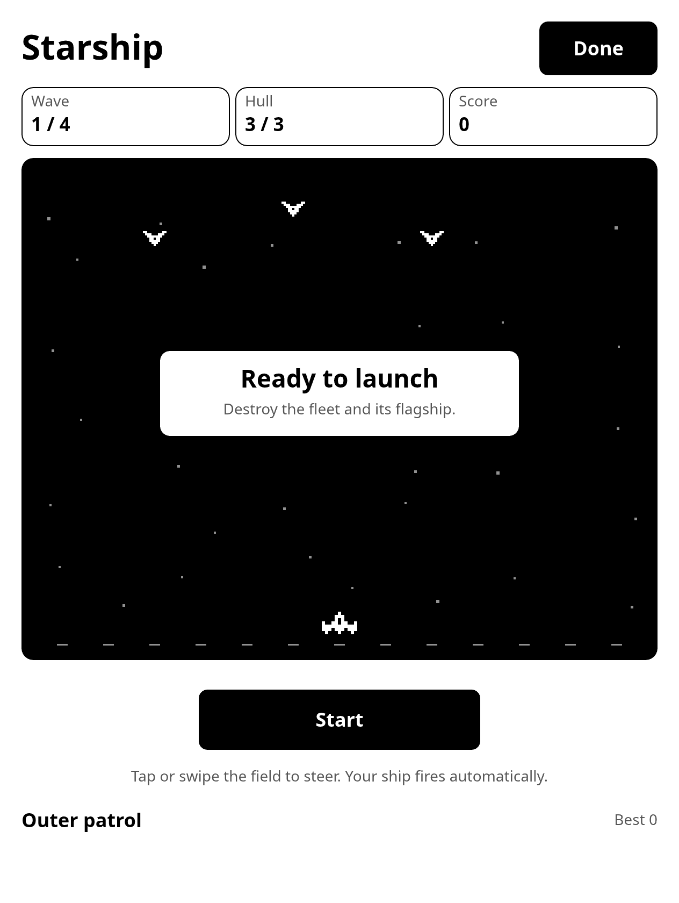
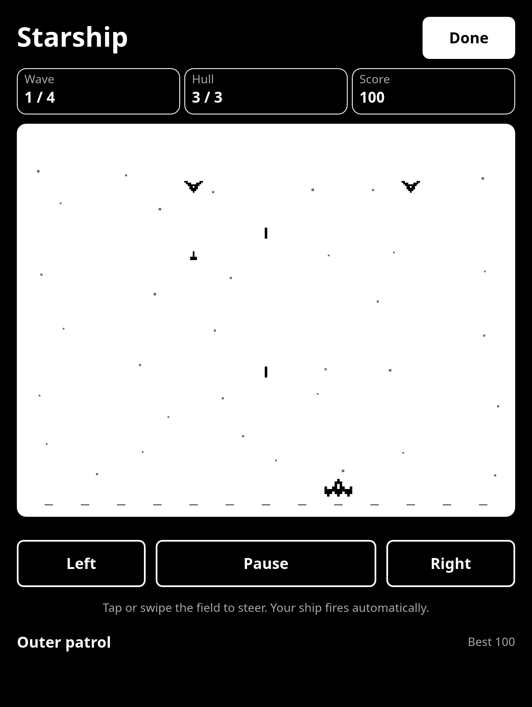

<div align="center">

# Starship

**A real-time space shooter for PrimitiveOS.**

Steer through incoming fire, clear three waves, and take down the flagship.



</div>

## Play

Tap **Start**, then tap a spot across the field to steer there. Swipe left or right to shift by several columns, or use **Left** and **Right** for single-column movement. Your ship fires while you steer. Straight streaks are your shots. Enemy bolts have a wider tip and travel toward your ship.

Clear the patrol, crossfire, and vanguard, then defeat the flagship. Guards and the flagship have health bars below them. You start with three hull points. Dodge shots and clear each wave before the fleet reaches the flight line. The next wave starts after a short break.

Tap **Pause** or **Done** whenever you need a break. Starship saves your mission and best score on the Kindle and plays offline. If you reopen Starship during a mission or return from sleep or USB drive mode, tap **Resume** to continue. Starship 0.1.1 saves arcade progress separately from the previous turn-based mode. [Paused mission screenshot](docs/images/starship-paused.png)



## Get it

Open **Store** in Primitive Launcher, refresh the catalog, and search for **Starship**. The GitHub release also includes an ARMHF package. [Installation guide](INSTALL.md)

## Build and preview

Place the PrimitiveOS Tools and Launcher checkouts beside this repository as `doannt-kindle-tools` and `doannt-kindle-launcher`. The desktop preview uses the Launcher fonts.

```sh
cargo test --locked --workspace
cargo run --locked -p starship-desktop -- build/previews
cargo zigbuild --locked --release -p starship-kindle --target armv7-unknown-linux-musleabihf
sh scripts/stage.sh armhf
```

## License

Starship code is [PolyForm Noncommercial 1.0.0](LICENSE). Documentation, screenshots, and original artwork are [CC BY-NC-SA 4.0](LICENSE-DOCS). The release ZIP includes both license files.
