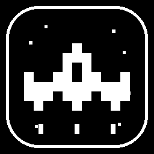

# Starship

**Dodge fire and defeat the flagship**

  

[**Download**](https://github.com/PrimitiveOS/kindle-primitive-starship/releases/latest) · [**Install guide**](INSTALL.md) · [**Changelog**](CHANGELOG.md)

---

Pilot a ship through three waves and a flagship encounter. Steer with taps or swipes, dodge enemy bolts, and line up your automatic shots. Play offline with saved progress and a best score.

## Quick start

After setting up PrimitiveOS, open **Store** from Primitive Launcher. Choose **Starship** under **Apps**,
tap **Get**, and open it from the Launcher grid. The [install guide](INSTALL.md) also covers the standalone USB package.

## Highlights

- Pilot a ship through three waves and a flagship encounter.
- Steer with taps or swipes, dodge enemy bolts, and line up your automatic shots.
- Play offline with saved progress and a best score.

## Status

| Device | Status |
|---|---|
| Kindle Oasis 3 (1264 × 1680, firmware 5.18.2) | Tested on hardware |

**Current version: 0.1.2.** Changes are in [CHANGELOG.md](CHANGELOG.md).

## Downloads

**46 downloads** from Store, as of 2026-11-21. Store shows the same count on the app page.
The count is GitHub downloads of this app's release packages, from the [Store catalog](https://primitiveos.github.io/kindle-primitive-catalog/v1/index.json).

## Documentation

[Install guide](INSTALL.md) · [Changelog](CHANGELOG.md)

## Licence

Starship code is [PolyForm Noncommercial 1.0.0](LICENSE). Documentation, screenshots, and original artwork are [CC BY-NC-SA 4.0](LICENSE-DOCS). The release ZIP includes both license files.
